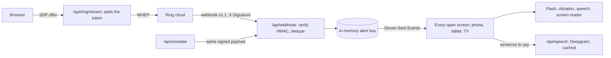

# Herald

**Your Ring doorbell, for every sense.**

Herald turns Ring doorbell and camera events into alerts people can see, hear or feel. It's for people who can't hear the chime (Deaf and hard of hearing), can't see the door (blind and low vision), or both (Deafblind).

Built for the Ring track of the Amazon "Build, Ship, Shape" hackathon.

## What it does

- **One event, every sense.** When Ring reports a doorbell press, a person, a package, a vehicle, movement, or the camera going offline, every open Herald screen responds in the ways its user can perceive:
  - a full-screen colour flash that stays until dismissed
  - a vibration rhythm that's different for each kind of event
  - spoken alerts in a natural voice (Deepgram Aura-2, with the browser's own voice as a fallback)
  - screen-reader announcements, which also reach refreshable braille displays
- **Set up per screen.** Each phone, tablet, laptop or TV picks a profile: Deaf or hard of hearing, Blind or low vision, Deafblind, or custom. Settings stay on that device, so a wall tablet and a phone in the same home can behave differently.
- **Only what matters interrupts.** Doorbell presses and camera problems always interrupt. People and packages interrupt by default. Vehicles and general movement go into History and interrupt only if you ask for everything.
- **Live view.** Watch the door over Ring's WHEP live stream. The Ring token stays on the server.
- **Works without a device.** A built-in simulator sends real HMAC-signed Ring webhooks (v1.1) to Herald's own endpoint, so the whole pipeline runs with nothing but the Ring Developer Playground. Simulated alerts are labelled "Simulated" on screen.

## How each event feels

| Event | Ring source | Priority | Flash | Vibration |
|---|---|---|---|---|
| Doorbell | `button_press` | Urgent | Amber | long, long |
| Person | `motion_detected`, `sub_type: human` | Normal | Sky blue | short, short |
| Package | `motion_detected`, `sub_type: package_delivery` | Normal | Green | short, long |
| Vehicle | `motion_detected`, `sub_type: vehicle` | Info | Lavender | long, short |
| Movement | `motion_detected`, `sub_type: motion` or `other_motion` | Info | Light grey | one tap |
| Camera offline | `device_offline` | Urgent | Orange | long, long, long |
| Camera back online | `device_online` | Info | Light grey | three taps |

Vibration uses the Vibration API, which Android browsers support and iOS Safari doesn't.

## Accessibility

Herald is an accessibility product, so these are requirements, not polish:

- **Contrast.** All text meets WCAG AAA (7:1) in the light and dark themes, and every border and focus ring meets 3:1. `npm run check:contrast` checks all 41 colour pairs, including the text on each alert colour. On alert colours the focus ring switches to the text colour so it never disappears.
- **Safe flashing.** The flash pulses at about 0.75 flashes a second for 4 seconds (WCAG 2.3.1 allows up to 3 a second) and avoids saturated red. Only the margins pulse; the text sits on a solid panel so its contrast never drops. With "reduce motion" on, the colour holds steady.
- **Screen readers.** Alerts go to live regions that are always in the page: assertive for urgent alerts, polite for the rest. The flash is a modal `alertdialog`. While it's up the rest of the page is `inert`, focus moves to Dismiss, and on dismiss focus goes back to where the person was.
- **Keyboard.** Everything works from the keyboard, with a skip link and a visible focus ring. When a control disappears after use (like the first-run setup), focus moves to the door status instead of dropping to the top of the page. First-run setup has a confirm button because arrow keys select radio buttons as they move: saving on select would have stored the first option a screen-reader user landed on.
- **Readable.** Atkinson Hyperlegible, a typeface the Braille Institute designed for low-vision readers, at an 18px base that follows the browser's text size. Controls are at least 24 by 24 px (WCAG 2.5.8).
- **Honest about browser limits.** Browsers block speech and vibration until someone interacts with the page. Herald says so on screen and turns them on at the first tap or key press.

## How it works



1. Ring POSTs a webhook to `/api/webhook`. Herald checks the `X-Signature` HMAC-SHA256 over the raw bytes before parsing anything, drops duplicates by `request_id` (Ring retries failed deliveries), turns the event into an alert, and answers well inside Ring's 5-second limit.
2. The alert goes onto an in-memory bus and out to every open screen over Server-Sent Events. A screen that connects later gets recent history without replaying the alerts.
3. Each screen applies its own profile and priority filter and fires its outputs. To speak, it asks `/api/speech` for the sentence. The server synthesises each of Herald's sentences once with Deepgram and serves it from memory after that (it warms them all when the first screen connects), so the key stays on the server. If there's no key, no answer within 2.5 seconds, or the browser won't play the audio, the browser's own voice says it instead.
4. For live view, the browser creates a WebRTC offer with one receive-only video track, as Ring documents. Herald's server relays it to Ring's WHEP endpoint with the token, so the token never reaches the browser.

### Ring APIs used

| API | Where | What for |
|---|---|---|
| Webhooks v1.1: `button_press`, `motion_detected` with `sub_type`, `device_online`, `device_offline` | `apps/web/app/api/webhook` | The alert source |
| `GET /v1/devices`, `GET /v1/devices/{id}/status` | `apps/web/app/api/ring/devices` | Camera list and online status |
| `POST /v1/devices/{id}/media/streaming/whep/sessions`, then `DELETE` on the session | `apps/web/app/api/ring/stream` | Live view |
| `POST /v1/devices/{id}/media/image/download` | `apps/web/app/api/ring/snapshot` | Latest still image |
| `GET /v1/users/me` | `apps/web/lib/server/ring.ts` | Account id for simulated webhooks |

All calls go through [ring-kit](packages/ring-kit), the open-source Ring client in this repo. It also covers capabilities, location, configurations, event history and clip downloads.

## Run it

You need Node.js 22.18 or newer.

```bash
npm install
```

```bash
cp apps/web/.env.example apps/web/.env.local
```

```bash
npm run dev
```

Open http://localhost:3000 and choose who uses the screen. The simulator works straight away, without a Ring token: press **Doorbell press** and the alert arrives.

To add live view with the Ring Developer Playground:

1. Open the [Ring Developer Playground](https://developer.amazon.com/ring/console/playground) and choose **Generate token**.
2. Put it in `apps/web/.env.local` as `RING_ACCESS_TOKEN=...`. The dev server reloads the file; refresh the page. Playground tokens last 30 minutes.
3. In the Playground, choose Package, Vehicle or Motion, then press **Start live view** in Herald. The stream plays that clip.

### Configuration

Set these in `apps/web/.env.local`.

| Variable | Default | What it does |
|---|---|---|
| `RING_ACCESS_TOKEN` | empty | Ring API token. Use a Playground token for development. |
| `RING_WEBHOOK_SIGNING_KEY` | random per run while the simulator is on | The HMAC key Ring signs webhooks with. Required in production. |
| `HERALD_DOOR_LABEL` | `front door` | What alerts call the door: "Someone is at the front door." |
| `DEEPGRAM_API_KEY` | empty | Herald's voice. Alerts are spoken with Deepgram Aura-2 (Orion). Empty: each browser's built-in voice. |
| `HERALD_SIMULATOR` | on in development, off in production | `on` or `off`. Shows the simulator and enables `/api/simulate`. |
| `HERALD_PASSWORD` | unset | One password for the whole app (HTTP Basic, any user name). Set it on any server reachable from the internet. |

## Deploy

- Run Herald as **one long-lived Node.js process** (`npm run build`, then `npm start`). It keeps the alert bus in memory and holds Server-Sent Events connections open, so serverless functions would split the webhook and the open screens across instances. A small container or VM works, for example AWS App Runner, Lightsail or EC2.
- Serve it over HTTPS, set `RING_WEBHOOK_SIGNING_KEY`, and point your Ring app's webhook URL at `https://your-host/api/webhook`.
- Set `HERALD_PASSWORD`. Herald relays live video from a real home, and without a password anyone who finds the URL could watch it. The webhook stays reachable because its signature is checked instead.

## Tests

```bash
npm test
```

```bash
npm run typecheck
```

```bash
npm run check:contrast
```

52 unit tests run on Node's built-in test runner: 27 for ring-kit and 25 for the web app. They cover webhook signing and verification (tampered bodies, re-serialized JSON, wrong keys, malformed headers), the simulator's payloads, the API client's redirects and errors, the event-to-alert mapping, preference sanitising, distinct vibration rhythms, the password gate, and Herald's voice (every alert sentence can be spoken, each is synthesised once, failures aren't cached).

## Project layout

```
packages/ring-kit/     Ring Partner API client, webhook verification, signed webhook simulator
apps/web/              Herald (Next.js)
  app/api/webhook/       Ring webhook receiver
  app/api/events/        Server-Sent Events to every open screen
  app/api/simulate/      Signed test webhooks
  app/api/speech/        Herald's voice (Deepgram, cached per sentence)
  app/api/ring/          Devices, live view relay, snapshots
  hooks/                 Alert stream, outputs (flash, vibration, speech, live regions), live view, preferences
  components/            The interface
  lib/                   Event-to-alert mapping, alert styles, preferences, server helpers
  proxy.ts               Optional password gate
  scripts/               Contrast check
```

## Security

- The Ring token never leaves the server. The browser only talks to Herald's own routes.
- Webhooks are verified with HMAC-SHA256 over the exact bytes received, compared in constant time, before anything is parsed. Repeated deliveries are dropped by `request_id`.
- Media downloads follow Ring's 303 redirect without the `Authorization` header, so the token never goes to the storage host. Ending a live session refuses any URL that isn't on Ring's API host.
- `HERALD_PASSWORD` protects every page and API route except the webhook.
- `/api/speech` voices only Herald's own alert sentences, so it can't be used as a free text-to-speech service. The sentence (for example "Doorbell. Someone is at the front door.") is the only thing sent to Deepgram: no video, images or account details.

## Limitations and next steps

- **Ring account linking.** Herald runs on an access token today, from the Playground. Production needs Ring's OAuth account linking and token refresh.
- **Alerts reach open screens.** A phone in a pocket only gets alerts while Herald is open. Web Push is the next step.
- **Memory only.** Alert history resets when the server restarts.
- **Next:** spoken descriptions of who is at the door, from a live-view frame, and a Fire TV layout.

## Credits

- [ring-api-helloworld](https://github.com/AmazonAppDev/ring-api-helloworld) was a reference for the Ring API. Herald doesn't copy its code; [FRICTION_LOG.md](FRICTION_LOG.md) explains where Herald departs from it and why.
- Icons from [Lucide](https://lucide.dev). Font: Atkinson Hyperlegible by the Braille Institute. See [THIRD_PARTY_NOTICES.md](THIRD_PARTY_NOTICES.md).
- Herald's voice: [Deepgram](https://deepgram.com) Aura-2, when a key is configured.

## License

MIT. See [LICENSE](LICENSE).
